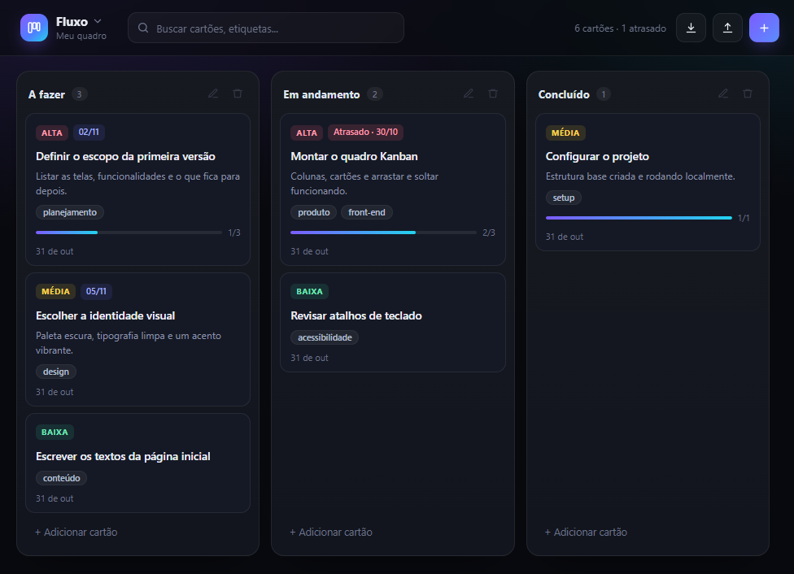
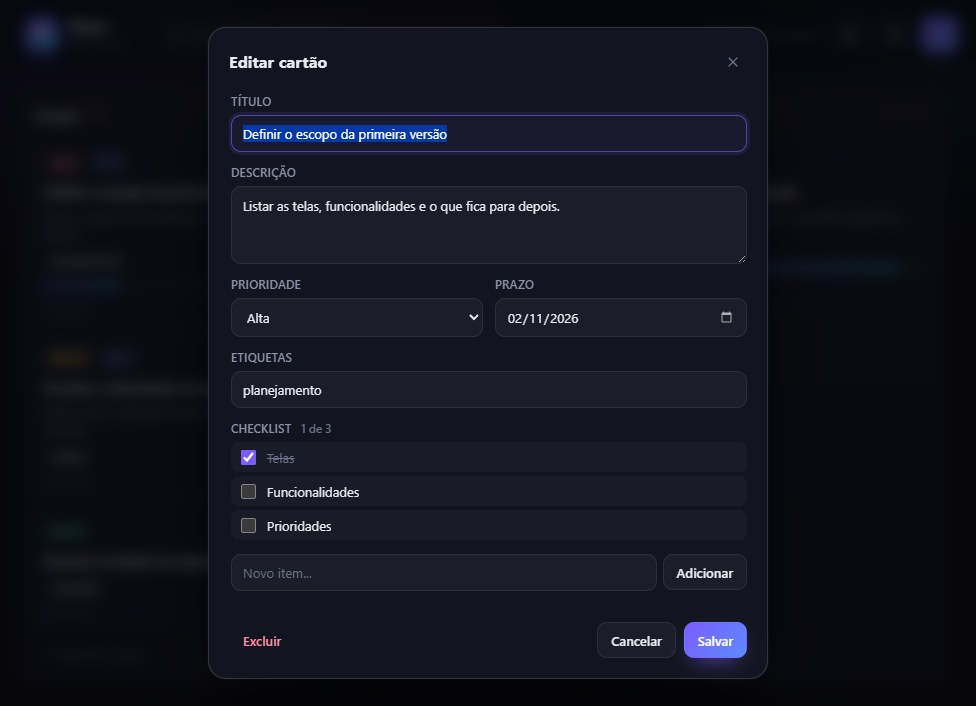

# Fluxo — Quadro Kanban

[](https://henriquesakita.github.io/fluxo-kanban/)
[](https://github.com/henriquesakita/fluxo-kanban/releases/latest)
[](LICENSE)
[](#baixar)

**Um código, quatro plataformas: navegador, Windows, Linux e Android.**

Quadro Kanban completo e offline, com interface em tema escuro escrita em HTML,
CSS e JavaScript puro, sem framework de UI.

`JavaScript` `Electron` `Capacitor` `GitHub Actions` `GitHub Pages`

**[Testar a demo no navegador](https://henriquesakita.github.io/fluxo-kanban/)** —
não precisa instalar nada.



## Destaques técnicos

- **Um código, quatro destinos.** A mesma base web é empacotada com Electron para
  Windows/Linux e com Capacitor para Android, sem reescrever a interface.
- **Zero dependências de runtime na UI.** Sem React, Vue ou bibliotecas de
  arrastar e soltar: só DOM, Pointer Events e `localStorage`.
- **Arrastar e soltar com mouse e toque.** O mesmo fluxo de `pointerdown` /
  `pointermove` / `pointerup` distingue rolagem vertical de arraste horizontal no
  celular e trata `pointercancel` sem abrir o editor por engano.
- **Dados que sobrevivem a atualizações.** Estado versionado (`fluxo.kanban.v2`)
  com migração automática do formato antigo (`fluxo.kanban.v1`), exportação e
  importação em JSON.
- **Entrega automatizada.** O GitHub Actions compila Windows (NSIS + portátil),
  Linux (AppImage + tar.gz) e Android (APK) em paralelo e publica tudo em um
  release ao enviar uma tag `v*`.

## Baixar

Os instaladores e o APK ficam na página de
**[Releases](https://github.com/henriquesakita/fluxo-kanban/releases/latest)**:

| Plataforma | Arquivo |
| --- | --- |
| Windows | `Fluxo-Setup-1.2.0.exe` (instalador) ou `Fluxo-Portable-1.2.0.exe` (portátil) |
| Linux x64 | `Fluxo-1.2.0-linux-x86_64.AppImage` ou `Fluxo-1.2.0-linux-x64.tar.gz` |
| Android | `Fluxo-1.2.0-android.apk` |

O instalador do Windows não é assinado digitalmente, então o SmartScreen pode
exibir um aviso na primeira execução: clique em **Mais informações** e depois em
**Executar assim mesmo**.

## Funcionalidades

- Múltiplos quadros com menu de troca, renomear e excluir
- Arrastar e soltar cartões entre colunas e reordenar dentro da coluna (mouse e toque)
- Criar, editar e excluir cartões com prioridade, prazo e etiquetas
- Prazos com destaque para hoje, amanhã e cartões atrasados
- Checklist por cartão com progresso visível no cartão
- Adicionar, renomear (duplo clique no título) e excluir colunas
- Busca por título, descrição e etiquetas
- Salvamento automático no `localStorage` do navegador
- Exportar e importar todos os quadros em JSON
- Desfazer exclusão de cartão
- Layout flexível: colunas crescem em telas largas e viram um carrossel no celular



## Stack

| Camada | Tecnologia |
| --- | --- |
| Interface | HTML, CSS e JavaScript puro (DOM + Pointer Events) |
| Persistência | `localStorage` com estado versionado e migração |
| Desktop | Electron 45 + electron-builder |
| Android | Capacitor 8 (WebView nativa) |
| CI/CD | GitHub Actions + GitHub Releases |
| Demo | GitHub Pages |

## Como rodar

### Navegador

Abra `index.html` com duplo clique ou sirva a pasta:

```bash
python -m http.server 5174
# http://localhost:5174
```

### Desktop (Windows/Linux)

```bash
npm install
npm start          # desenvolvimento
npm run build      # instalador + portátil para Windows
```

### Android

```bash
npm install
npm run android:sync
cd android
./gradlew assembleDebug
```

O APK sai em `android/app/build/outputs/apk/debug/app-debug.apk`. O SDK e o JDK
não são necessários na máquina: o workflow do GitHub Actions compila o APK.

## Estrutura

```
index.html              marcação e modal de edição
styles.css              tema escuro, layout e ajustes para toque
app.js                  estado, renderização, arrastar e soltar, persistência
electron/main.js        janela do app desktop (Electron)
capacitor.config.json   configuração do app Android (Capacitor)
android/                projeto Android nativo gerado pelo Capacitor
www/                    cópia dos arquivos web usada pelo Android e pela demo (gerada)
build/                  ícones do app e script dos ícones do Android
linux/                  instalador e leia-me do pacote Linux
scripts/                empacotamento Linux e sincronização do www
docs/                   capturas de tela usadas neste README
dist/                   instaladores e pacotes gerados
```

Os dados ficam salvos apenas no dispositivo (navegador, app desktop ou app
Android). Para levar os quadros para outro lugar, use **Exportar** e depois
**Importar**.

## Publicar uma versão

O workflow `.github/workflows/release.yml` roda ao enviar uma tag `v*`:

```bash
git tag v1.2.0
git push origin v1.2.0
```

Ele compila Windows, Linux e Android em paralelo e publica tudo em um release do
GitHub. A demo web é publicada separadamente pelo workflow
`.github/workflows/pages.yml` a cada alteração em `index.html`, `styles.css` ou
`app.js`.

## Autor

**Henriques Sakita** — [github.com/henriquesakita](https://github.com/henriquesakita)

Licenciado sob a [MIT](LICENSE).
